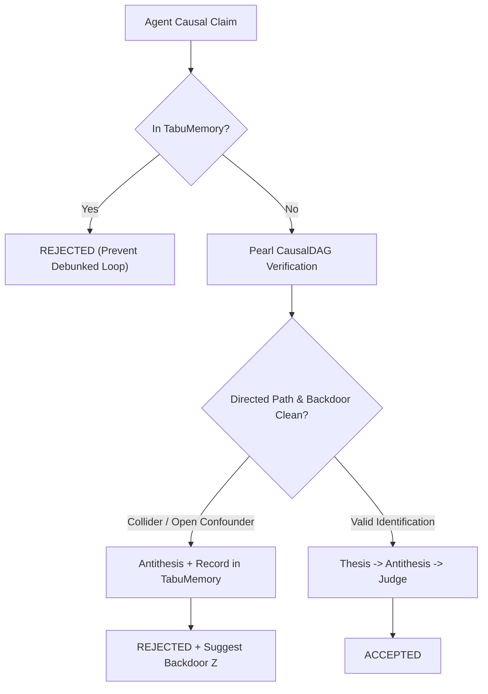

# EvoNova Causal Guard

[](https://github.com/pokushko/evonova-causal-guard/actions/workflows/ci.yml)
[](https://www.python.org/downloads/)
[](LICENSE)
[](https://github.com/pokushko/awesome-autonomous-agent-resilience)

**Zero-dependency Pearl *do*-calculus DAG verifier, Tabu memory archive, and multi-agent debate arbiter that stops LLM agents from confusing correlation with causation.**



---

## Key Capabilities

- **`CausalDAG`:** Strict acyclicity checks (`CycleError`), graph mutilation via Pearl's `do(X)` operator, exact Bayes-Ball `d_separated(X, Y, Z)` queries, minimal `find_backdoor_adjustment_sets(treatment, outcome)`, and `detect_collider_bias(...)`.
- **`TabuMemory`:** Canonical SHA-256 + normalized token Jaccard similarity memory with optional TTL preventing agents from looping back onto falsified claims.
- **`DebateArbiter`:** Asynchronous `Thesis -> Antithesis -> Judge` referee pipeline pairing deterministic structural verification with pluggable sync/async LLM agent hooks.
- **Technical Alignment:** Clean-room reference implementation of causal-graph verification and multi-agent hypothesis arbitration concepts explored at EvoNova Labs (Siberian Federal University / VAK 2.3.1; Rospatent software architecture *«Система каузального анализа»* № 2026690237 & *«Модуль коллективной верификации гипотез на основе искусственного интеллекта»* № 2026667533).

---

## Quickstart

```bash
git clone https://github.com/pokushko/evonova-causal-guard.git
cd evonova-causal-guard
pip install -e .
```

### Usage Example

```python
import asyncio
from evonova_causal_guard import CausalClaim, CausalDAG, DebateArbiter

dag = CausalDAG([
    ("Severity", "Drug"),
    ("Severity", "Recovery"),
    ("Drug", "Recovery"),
])

arbiter = DebateArbiter(dag)

async def main() -> None:
    # 1. Naive claim ignoring confounder Severity -> REJECTED + recommends {"Severity"}
    bad = CausalClaim(statement="Drug improves Recovery directly", treatment="Drug", outcome="Recovery")
    print(await arbiter.verify(bad))

    # 2. Properly stratified claim -> ACCEPTED
    good = CausalClaim(
        statement="Drug improves Recovery conditioned on Severity",
        treatment="Drug",
        outcome="Recovery",
        proposed_adjustments={"Severity"},
    )
    print(await arbiter.verify(good))

asyncio.run(main())
```

---

## Verification & Tests

```bash
pip install pytest ruff
ruff check --select E,F --ignore E501 .
pytest -v
```

---

## 🌐 EvoNova Labs Open-Source Ecosystem

Part of the **[EvoNova Labs](https://pokushko.github.io)** open-source AI resilience & scientific integrity stack by **[Roman Pokushko](https://github.com/pokushko)**:

| Project | Role in Stack | Link |
| :--- | :--- | :--- |
| **Awesome Agent Resilience** | Curated index (`160` entries), MAST/OWASP Failure Taxonomy & `F01–F10` chaos benchmark | [pokushko/awesome-autonomous-agent-resilience](https://github.com/pokushko/awesome-autonomous-agent-resilience) |
| **AgentBunker** | 24/7 WAL intent journal, RSS memory ceiling watchdog & tri-state circuit breakers | [pokushko/agent-bunker](https://github.com/pokushko/agent-bunker) |
| **Orchestration Engine** | Zero-dependency `asyncio` MAS router, Kahn DAG waves & consensus reducers | [pokushko/orchestration-engine](https://github.com/pokushko/orchestration-engine) |
| **Agent Security Sandbox** | Pre-flight Python AST guard against dunder escapes & prompt-injection sanitizer | [pokushko/agent-security-sandbox](https://github.com/pokushko/agent-security-sandbox) |
| **Agentic Vector Memory** | Dual-store episodic & semantic memory with exponential decay & SQLite persistence | [pokushko/agentic-vector-memory](https://github.com/pokushko/agentic-vector-memory) |
| **EvoNova Causal Guard** | Pearl *do*-calculus DAG verifier, Tabu memory & multi-agent debate arbiter | [pokushko/evonova-causal-guard](https://github.com/pokushko/evonova-causal-guard) |
| **Sci Integrity Guard** | Cross-table numeric parity linter, CrossRef/OpenAlex DOI checker & LaTeX-to-OMML | [pokushko/sci-integrity-guard](https://github.com/pokushko/sci-integrity-guard) |
| **KTK ELOU-AVT Core** | Industrial cybernetic digital twin prototype for crude oil ELOU-AVT units | [pokushko/ktk_elou_avt_core](https://github.com/pokushko/ktk_elou_avt_core) |
| **EvoNova Chem Core** | RDKit molecular descriptor screening core for physical constraint enforcement | [pokushko/evonova-chem-core](https://github.com/pokushko/evonova-chem-core) |

---

## License

MIT License. Copyright (c) 2026 [Roman Pokushko](mailto:pokusko.roman@gmail.com). See [LICENSE](LICENSE).
